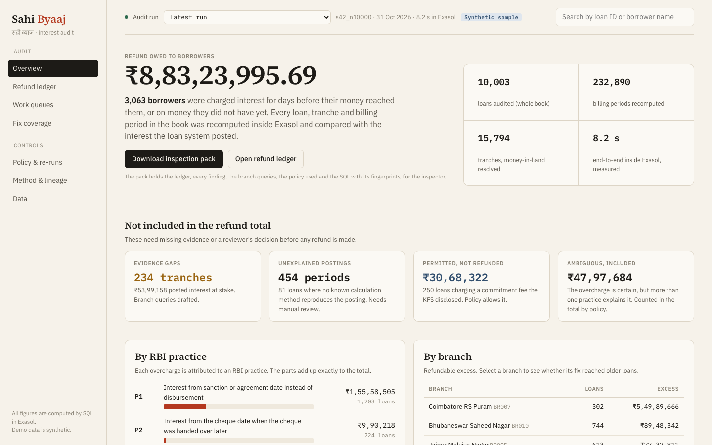
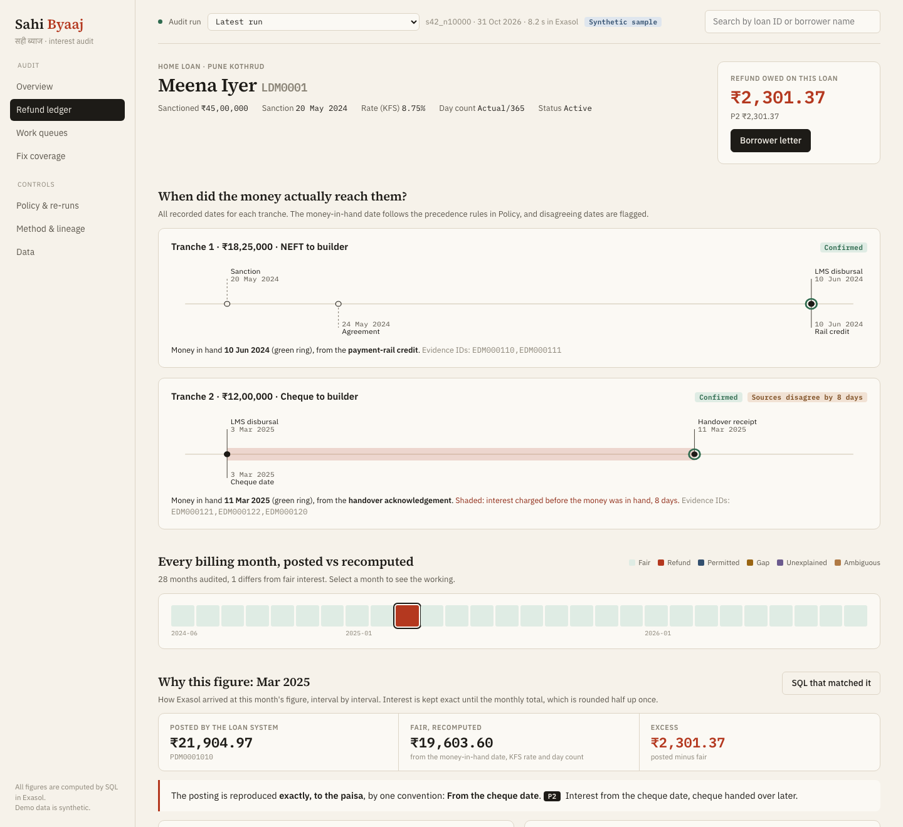
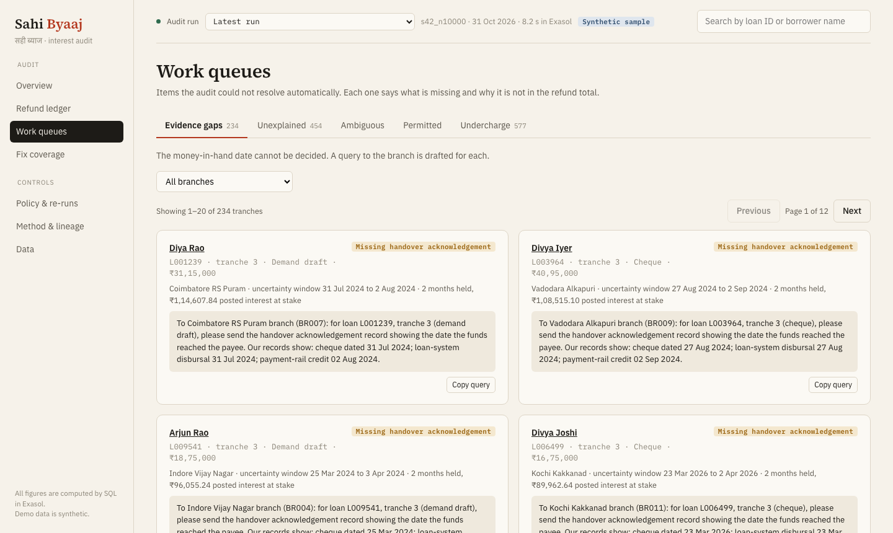
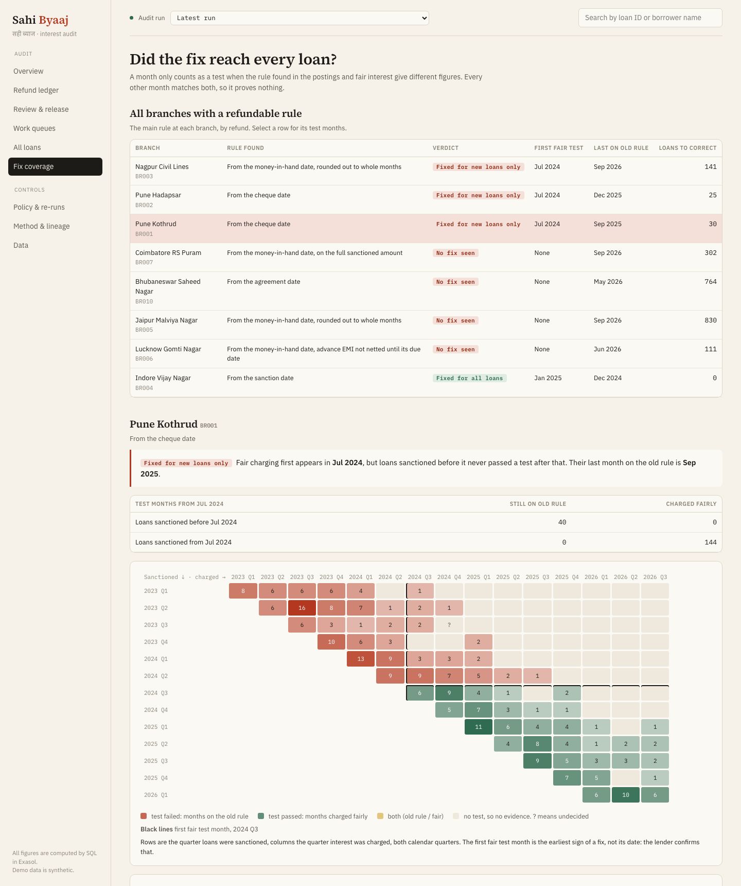

# Sahi Byaaj

> **ExaThon India 2026 submission**
> - Pitch deck: https://drive.google.com/file/d/1v10LGziEamFKlyzJWvKxxAMamGbhpRfG/view?usp=sharing
> - Demo video: https://drive.google.com/file/d/1V9NrbypIhyThks5st7lm19ksZvIW5QiB/view?usp=sharing

[](https://github.com/aryankalra404/Exasol/actions/workflows/ci.yml)

**A full-book interest audit for Indian lenders, built on Exasol Personal.**
ExaThon India 2026, Track 01: Money, Risk & Regulation. [MIT licence](LICENSE)

## Overview

> An internal auditor at a housing finance company can't show that no borrower paid interest for days before their money actually reached them, because the dates that decide interest sit in records that disagree, and the only thing computing interest is the loan system she is supposed to be checking. If this worked, she would know every overcharged borrower and the exact refund owed, with evidence, before the regulator's inspection finds it.

In April 2024 RBI found lenders charging interest from the sanction date, from the date on a cheque handed over days later, for whole months when money was out for part of one, and on advance EMIs already collected. It told them to refund, and in July 2026 wrote these practices, plus two new ones on part-disbursed loans, into its supervisory directions.

Sahi Byaaj checks this for every loan, every tranche and every day, inside Exasol:

- **Finds the day the money actually reached the borrower** from conflicting records (LMS date, cheque date, handover acknowledgement, payment-rail credit), with an editable precedence rule and visible conflicts
- **Names the rule the lender's system applied** by recomputing each posting under 33 candidate conventions and matching to the paisa. Nothing is labelled from outside; the posting is the evidence
- **Separates unfair practice from disclosed, permitted terms** using the Key Facts Statement and an editable policy
- **Produces a paisa-exact refund ledger** with lineage to source rows and the SQL step behind each figure
- **Shows what it cannot decide** (evidence gaps, unexplained postings) instead of guessing, with a drafted query to the branch for every gap

Every number is computed by SQL inside Exasol; the app only reads result tables. All data is synthetic. See [LIMITS](docs/LIMITS.md).



### The three demo loans

| Loan | What happened | What Sahi Byaaj says |
|---|---|---|
| **Meena**, home loan, `LDM0001` | Tranche 2 of ₹12,00,000 at 8.75%: cheque dated 3 Mar 2025, handover acknowledged 11 Mar | Posting reproduced exactly by "from the cheque date" (P2). Excess 8 days = **₹2,301.37** (12,00,000 × 8.75% × 8 / 365) |
| **Raghav**, home loan, `LDM0002` | Charged from sanction date, but his KFS discloses a commitment fee and the posting reproduces it | **PERMITTED** under default policy, ₹0 refund, reason shown. Flip the policy and it becomes a P1 refund |
| **Asha**, home loan, `LDM0003` | Cheque tranche, no handover record, cheque date and rail credit 4 days apart | **EVIDENCE_GAP**: kept out of the total, query to the branch drafted |



### Results, as measured

Exasol Personal local, single node, VM with 2 vCPU. Demo and 100k books: VM 8 GB on an Apple M4 MacBook (16 GB), 30 Oct 2026. 500k book: VM 12 GB on an Apple M4 MacBook Air (24 GB), 31 Oct 2026. Raw reports in [eval/reports](eval/reports).

| | Demo book | 100k book | 500k book |
|---|---|---|---|
| Loans / tranches | 10,003 / 15,794 | 100,003 / 157,461 | 500,003 / 785,974 |
| Interest postings | 234,195 | 2,342,745 | 11,702,698 |
| Billing periods recomputed | 232,890 | 2,329,775 | 11,639,169 |
| Full audit inside Exasol, end to end | 16.2 to 17.4 s | 120.6 s | 479.0 s |
| Independent oracle agreement | 232,890 of 232,890 periods, all loans | 70,361 of 70,361 periods, random 3,003 loans | 69,895 of 69,895 periods, random 3,003 loans |
| Largest deviation from oracle | 0 paise | 0 paise | 0 paise |

- **Fingerprint accuracy** (demo book, against the generator's hidden configuration): every one of 7,535 MATCHED periods names the hidden convention (6,612) or one giving the identical figure (923); all 2,072 PERMITTED periods are exact. Undecided periods go to EVIDENCE_GAP (252), UNEXPLAINED (454) or AMBIGUOUS (385); every UNEXPLAINED period traces to a planted defect
- **False positives: 0.** Disclosed commitment fees, a disclosed 30E/360 basis and fairly posted months never reach the ledger (`tests/test_false_positives.py`)
- **Public anchor:** RBI's own KFS illustration (₹20,000 at 15% over 24 months; RBI prints EMI ₹970, interest ₹3,274, APR 17.07%) runs through the full SQL pipeline: exact EMI ₹969.73, every month fair, printed figures match (`tests/test_rbi_fixtures.py`)
- **Blind round** (`make red-team`): 12 machine-written adversarial loans from the rules alone, with no access to the code. It found one real bug that the SQL and the oracle shared, since fixed: 59 of 60 months on the first run, 60 of 60 after. A person's review is still to come. See [RED_TEAM](docs/RED_TEAM.md)
- **Robustness** (`make robustness`): with no defects the refund total equals the true unfair excess exactly; with 1,338 and 4,057 planted defects it recovers 98.37% and 96.82%, and the rest waits in the gap and unexplained queues. No level refunds a single fair or permitted month

## Setup

Needs macOS on Apple Silicon (or Linux/WSL) with at least 8 GB RAM, Python 3.11+, Node 18+.

```bash
# 1. Install and start Exasol Personal, local
curl https://www.exasol.com/install/starter-kit.sh | sh
exasol install local

# 2. Connection: copy the template, then put the password from
#    ~/.exasol/personal/deployments/default/secrets.json into .env
cp .env.example .env

# 3. Python + web dependencies
make setup

# 4. Generate a 10,000-loan synthetic book, load it into Exasol, run the audit
make demo LOANS=10000

# 5. Check it: tests, and the independent oracle against every loan
make test
make oracle LOANS=10000
```

## Usage

### Run the auditor app

```bash
make app        # http://127.0.0.1:8000
```

Start on **Overview**, click Meena's loan (`LDM0001`), then try the work queues and policy page.

- **Overview**: the refund total, where every loan landed (correct, refund owed, or another outcome), what is held out of the total and why, excess by RBI practice and branch, *what the loan system was actually doing*, and a one-click **inspection pack** (ledger, findings, branch queries, policy used, SQL with SHA-256)
- **Loan**: every date source per tranche on one timeline, every billing month posted vs recomputed, and *why this figure*, interval by interval, down to the SQL step
- **Refund ledger**: filter, sort, export CSV
- **Review & release**: review by root cause, with the reason and evidence level on each row. A person approves or holds each refund with a name and reason; a re-run that changes a figure sends it back; only approved letters can be released, as a ZIP and manifest for the lender's own channels. This tool never contacts a borrower
- **Work queues**: evidence gaps with drafted branch queries, and entry of the branch's reply: enter the date, re-run, and the same SQL rules decide the result. Also unexplained, ambiguous, permitted, undercharge
- **Fix coverage**: sanction-cohort × charge-quarter heatmap. A fix that covered only new loans shows as old cohorts still being charged
- **Policy & re-runs**: flip an interpretation, re-run the whole book in Exasol, compare runs loan by loan
- **Letter**: borrower refund letter in English, Hindi or Tamil, every figure from the ledger, rejected by the checker if any figure differs
- **Method & lineage**: each SQL step with its file, SHA-256 and timing
- **Data**: download the template, **upload your own extract as a ZIP**; each file is checked against the table definitions before Exasol changes, then loaded and audited. Reload the sample from the same page

| Work queues: what the audit cannot decide, with the query to each branch | Fix coverage: a fix that reached new loans only |
|---|---|
|  |  |

### Commands

| Command | What it does |
|---|---|
| `make generate LOANS=10000` | Synthetic book into `data/s42_n10000` (`SEED=42` default, deterministic) |
| `make load LOANS=10000` | Create schemas and IMPORT the book into Exasol |
| `make audit` | Run the SQL pipeline (`sql/10..90`) inside Exasol, recording timings and lineage |
| `make demo LOANS=10000` | generate + load + audit |
| `make review-reset` | Clear review records and entered evidence for the loaded synthetic book, to rehearse the demo |
| `make tamper`, `make tamper-undo` | Add one paisa to Meena's March 2025 posting, or take it back, to show the audit catching it. Re-run the audit after each |
| `make test` | pytest (database tests skip without `.env`) |
| `make oracle LOANS=10000` | Independent Python oracle vs the latest run, every loan |
| `make scale LOANS=500000` | Big book in separate `SCALE_*` schemas, report in `eval/reports/` |
| `make robustness LOANS=10000` | Defect levels 0, 1, 3 in `ROB_*` schemas, report in `eval/reports/robustness.json` |
| `make app` | Build the UI and serve API + UI on http://127.0.0.1:8000 |
| `make red-team-template`, `make red-team` | Blind red team in `RT_*` schemas, see [RED_TEAM](docs/RED_TEAM.md) |
| `make ask-setup && make ask-smoke` | Read-only views and user for MCP, then an end-to-end check |

### Ask the book (optional, any MCP client)

"How much do we owe borrowers disbursed by cheque in 2024?" is answered by SQL over read-only views through Exasol's MCP server, with the SQL shown. The assistant's database user cannot read the truth tables or borrower names, or write anything. See [ASK](docs/ASK.md).

### Troubleshooting

- **SSL or connection errors on `localhost:8563` while the database is running** (seen on macOS after the laptop woke from sleep): the launcher's port forward can lose its route to the VM. Set `EXASOL_DSN=<VM IP>:8563` in `.env`; the IP is in `local/runtime/vm.log` under the deployment directory

- **Connection refused on `localhost:8563`**: the database is stopped. Run `exasol status`, then `exasol start`
- **Authentication failed**: the password in `.env` must match `~/.exasol/personal/deployments/default/secrets.json`
- **Overview shows a different book**: an uploaded ZIP replaced the sample. Reload it on the Data page or run `make demo LOANS=10000`

## How it works

```
generator (synthetic book + simulated LMS with a hidden per-branch config)
   └─ CSV ──IMPORT──► Exasol SAHI_RAW
                         └─ sql/10..90, in Exasol ──► SAHI_OUT ──► API + UI, letters
oracle (independent Python, day by day) ──► compared with SAHI_OUT, to the paisa
```

- **Exact arithmetic**: each interval's interest is the integer `balance_paise × rate × days`; each month is rounded half up once with integer `DIV`. No floats anywhere
- **Intervals, not days**: balances change a few dozen times per loan, so the SQL works on constant-balance intervals clipped to billing months
- **All 33 conventions at once**: each convention is stored only as its difference from the fair path (often two rows), so candidate figures are fair + difference, computed side by side
- **Fingerprint, then label**: the convention that reproduces the posting names the practice; ties are broken by the loan's own posting history. Excess is always posted minus fair, so a wrong label can never change a refund

## Docs

| Doc | What |
|---|---|
| [PROBLEM](docs/PROBLEM.md) | Problem, users, evidence, sources |
| [SPEC](docs/SPEC.md) | Scope and acceptance criteria |
| [DOMAIN](docs/DOMAIN.md) | Interest rules, conventions, RBI practice codes |
| [ARCHITECTURE](docs/ARCHITECTURE.md) | Components and data flow |
| [CONTRACT](docs/CONTRACT.md) | Tables and interfaces |
| [WHY_EXASOL](docs/WHY_EXASOL.md) | Pipeline step → SQL file map, what runs in Exasol and why |
| [ASK](docs/ASK.md) | Ask the book over MCP, read-only |
| [FEATURES](docs/FEATURES.md) | Feature thinking: built, next, rejected |
| [DECISIONS](docs/DECISIONS.md) | Decision log |
| [LIMITS](docs/LIMITS.md) | Limitations and assumptions |

## Licence and contributing

[MIT](LICENSE). See [CONTRIBUTING](CONTRIBUTING.md).
